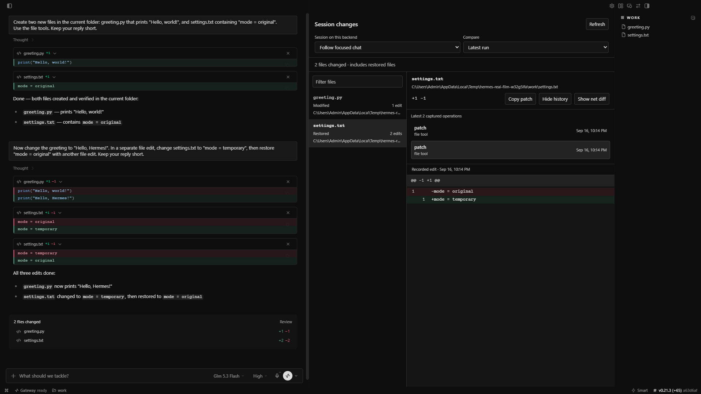

<div align="center">

<a href="https://github.com/NousResearch/hermes-agent">
  
</a>

# Session Diff

**See what changed. Even after the session ends.**

A file-by-file record of your Hermes runs, with quick diffs and individual edit history. Changes stay available after a restart, including edits that were later undone.

<sub>POWERED BY <a href="https://github.com/NousResearch/hermes-agent">HERMES AGENT</a> &nbsp;·&nbsp; COMMUNITY PLUGIN &nbsp;·&nbsp; VERSION 0.1.0</sub>

<br /><br />

[See what it does](#every-run-in-one-pane) &nbsp;·&nbsp; [Watch the demo](https://github.com/Adolanium/hermes-session-diff/releases/download/v0.1.0/hermes-session-diff-real-app.mp4) &nbsp;·&nbsp; [Install](#install) &nbsp;·&nbsp; [Capture limits](docs/reference.md#what-is-captured)

</div>



## Powered by Hermes

Session Diff uses the existing Hermes Agent hooks, tool middleware, and Desktop plugin SDK. The recorder runs on your gateway; the viewer follows your Desktop theme. No fork, upstream patch, extra server, API key, or model call. The Desktop component is already built.

## Every run in one pane

| | |
| --- | --- |
| **Find the files**<br />Follow the focused chat, select a recorded session, or filter the file list. Added, modified, deleted, and restored files have distinct labels. | **Read the diff**<br />See line numbers, additions, and deletions. Copy the displayed patch when you need it elsewhere. |
| **Trace an edit**<br />Open individual captured operations. A file changed and restored still has a history, even when its net diff is empty. | **Choose the scope**<br />Compare the latest run, an earlier run, or the whole session. The journal survives commits and app restarts. |

The viewer is read-only. It does not stage, commit, revert, or edit your files.

Hermes already includes inline tool diffs, a changed-files card, and Git Review. This plugin adds a persistent journal across runs, intermediate versions, and bounded capture around terminal commands.

## Install

Use Hermes Desktop **0.21.3 or newer** with combined-package support. Install on the machine running your gateway:

```sh
hermes plugins install Adolanium/hermes-session-diff
hermes plugins enable hermes-session-diff
```

Restart the gateway. In Desktop, rescan or reload plugins, then enable **Session changes** under **Capabilities → Plugins**. Open the right pane, or choose **Open session changes** in the command palette.

Both components matter: the Agent component records changes, and the Desktop component displays them. Recording begins with new tool calls after the recorder is enabled.

Prefer a download? Extract the [release ZIP](https://github.com/Adolanium/hermes-session-diff/releases/download/v0.1.0/hermes-session-diff-0.1.0.zip) into your profile's `$HERMES_HOME/plugins/` directory, then enable the plugin and restart as above. See the [reference](docs/reference.md#installation-details) for profile paths and remote gateways.

## Try it

1. Start a chat in an empty folder and ask Hermes to create a small text file.
2. Run another prompt that edits the file, then restores it in a separate tool call.
3. In **Session changes**, select **Latest run**. The file is marked **Restored**.
4. Open **Edit history** to see both edits. Restart Hermes and reopen the session; the history is still there.

The [60-second demo](https://github.com/Adolanium/hermes-session-diff/releases/download/v0.1.0/hermes-session-diff-real-app.mp4) shows this in the real Windows app, including the restart. Cursor animation and zooms are added in the video; waiting time is shortened.

## Stored in DynamoDB and S3

This fork replaces the local SQLite file with **DynamoDB** (run and change records) and **S3** (snapshot contents), so the journal works on read-only, ephemeral or network filesystems and can be read from any host with access. Set `SESSION_DIFF_TABLE` and `SESSION_DIFF_BUCKET` (or the `dynamodb_table` / `s3_bucket` settings); see [storage and limits](docs/reference.md#storage-limits-and-settings) for the table schema and IAM permissions. Retention is **30 days** by default; each prune handles a bounded number of records per run. Blobs are re-uploaded on every reference, so a bucket lifecycle rule (if any) is measured from the last reference; keep retention at or below it. `s3:ListBucket` is not needed (missing snapshots show as "no longer available"). Each blob is charged to the byte budget exactly once (a `charged` flag on its reference record) and refunded only if charged; deleting a blob uses an owner token so a stalled deleter cannot remove a re-uploaded object; a failed write removes its change rows before releasing blobs (if that cannot be confirmed the references are kept); and a session's META/RUN records are pruned only when the session has no changes left. A crash mid-write can leak a reference and bytes: the blob is kept rather than lost, but the byte counter does not self-correct. See [consistency and known limits](docs/reference.md#consistency-and-known-limits). The plugin adds no telemetry or model requests. A remote Desktop viewer reads the journal through your gateway's authenticated connection.

Snapshots contain file contents. Common credential filenames, ignored dependency directories, binary files, and oversized text are excluded or recorded as metadata only. These filters cannot detect every secret embedded in an ordinary source file. See [storage and limits](docs/reference.md#storage-limits-and-settings) for exact defaults and configuration.

Capture covers explicit file tools and bounded workspace changes observed around local terminal calls. Concurrent edits may be included; writes outside the captured workspace or after a tool returns may be missed. Docker and SSH terminal execution backends are not supported for content capture. A remote gateway using its own local terminal is supported.

## Development

```sh
npm ci
npm run build
npm test
python -m unittest discover -s tests -p 'test_*.py'
python scripts/package.py
```

See [integration and browser checks](docs/reference.md#development-checks) for tests using real Hermes tools and the viewer's history, error recovery, and theme contrast.

Updates use Hermes's plugin update commands. Catalog installs, once admitted, follow reviewed commit pins. This plugin never downloads or replaces its own code.

MIT licensed. Independent community plugin; not affiliated with or endorsed by Nous Research.
